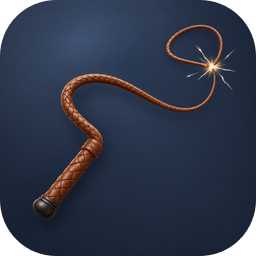

# hub-plugin-whip

A page plugin for [Agents Hub](https://github.com/flagman/agents-hub-core) on the model of
["Hammer"](https://github.com/flagman/hub-plugin-hammer): a "Whip" button in the top strip. A handle at the cursor, a
flexible lash follows the hand; a click is a crack: the lash shoots out, a welt stays on the "screen", sparks and a
sound. Esc or "Clear marks" puts everything back.

It is a layer over the page: the hub under it keeps working while the whip is in hand, clicks do not reach it. With
"Reduce motion" there is no lash physics, only the mark and the sound. Everything is drawn by code: no files, no
network, the hub's data is not read.
